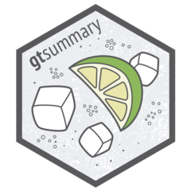

# Analysis Results Data

## Every number is saved

::: {.columns .v-center-container}
::: {.column width="40%"}

- Every calculation in {gtsummary} is stored as an [Analysis Results Dataset (ARD)]{.emphasis}

- An ARD is a long, [machine-readable]{.emphasis} data frame: one row per statistic

```{=html}
<div class="hex-flow">
  <figure>
    
    <figcaption>ARDs</figcaption>
  </figure>
  <span class="hex-flow-arrow" aria-hidden="true">&#8646;</span>
  <figure>
    
    <figcaption>Tables</figcaption>
  </figure>
</div>
```

:::

::: {.column width="60%"}

```{r}
#| label: ard-example-tbl
tbl <-
  adsl |>
  tbl_summary(
    by = ARM2,
    include = c(AGE, FEMALE)
  ) |>
  add_p()
tbl
```

:::
:::

## ...and can be extracted

`gather_ard()` returns the ARDs behind every number in the table.

```{r}
#| label: ard-example-extract
#| message: true
#| R.options:
#|   pillar.print_max: 6
#|   pillar.print_min: 6
ard <- gather_ard(tbl)

ard$tbl_summary |>
  dplyr::filter(variable == "AGE", stat_name %in% c("median", "p25", "p75"))
```

::: aside
::: {.small}
ARDs hold both the raw and formatted values. Save them (rds, json, …), reuse them for QC, or feed them into other outputs. ARDs are built with [{cards}](https://pharmaverse.github.io/cards/).
:::
:::

## ...or start from an ARD

The `tbl_ard_*()` functions build a table directly from an ARD.

::: {.columns}
::: {.column width="65%"}

```{r}
#| label: ard-first-build
ard <-
  cards::ard_stack(
    adsl,
    .by = ARM2,
    cards::ard_summary(variables = AGE),
    cards::ard_tabulate_value(variables = FEMALE),
    .attributes = TRUE,
    .missing = TRUE
  )

tbl_ard <-
  ard |>
  gtsummary::tbl_ard_summary(by = ARM2)
```

:::

::: {.column width="35%"}

```{r}
#| label: ard-first-table
#| echo: false
tbl_ard
```

:::
:::

::: aside
::: {.small}
The family: `tbl_ard_summary()`, `tbl_ard_continuous()`, `tbl_ard_wide_summary()`, `tbl_ard_hierarchical()`, and `tbl_ard_strata()`. Compute the statistics anywhere, then let {gtsummary} format them.
:::
:::
