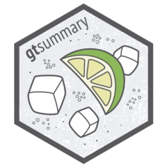

# In Closing

## Three ideas to take home

::: {.fragment}
### `r fontawesome::fa("table-cells", fill = fa_fill)` Consistent verbs, every table

One consistent set of `tbl_*()` verbs — from a *demographics table* to nested adverse event tables.
:::

::: {.fragment}
### `r fontawesome::fa("shield-halved", fill = fa_fill)` ARD-backed means trust

Every number is saved as an ARD — [traceable and extractable]{.emphasis} via `gather_ard()`.
:::

::: {.fragment}
### `r fontawesome::fa("arrow-up-right-dots", fill = fa_fill)` Encode it, then scale it

A shared theme captures your house standards; a [coding agent applies them]{.emphasis} without reminders.
:::

## Where to go next

::: columns
::: {.column width="50%"}
`r fontawesome::fa("book", fill = fa_fill)` Docs & cheat sheet — [danieldsjoberg.com/gtsummary](https://www.danieldsjoberg.com/gtsummary/)

::: {.small}
The [full function reference](http://www.danieldsjoberg.com/gtsummary/reference/index.html), and a detailed [`tbl_summary()` vignette](http://www.danieldsjoberg.com/gtsummary/articles/tbl_summary.html)
:::

 

`r fontawesome::fa("chalkboard-user", fill = fa_fill)` [Enterprise {gtsummary}](https://ddsjoberg.github.io/rpharma-workshop-gtsummary-adoption-2026/) — the full R/Pharma 2026 workshop

::: {.small}
More detail on everything in this talk, from the workshop much of this deck is adapted from
:::
:::

::: {.column width="50%"}
`r fontawesome::fa("images", fill = fa_fill)` [Table gallery](https://www.danieldsjoberg.com/gtsummary/articles/gallery.html) — worked examples of common tables

 

`r fontawesome::fa("stack-overflow", fill = fa_fill)` Ask on [stackoverflow.com](https://stackoverflow.com/questions/tagged/gtsummary) — *use the gtsummary tag*. Just kidding — nobody uses Stack Overflow anymore; ask an AI.
:::
:::

## Thank you

::: {.columns .v-center-container}
::: {.column width="55%"}

::: {.small}
[`r gtsummary_downloads` installations]{.emphasis} — go build something cute.
:::
:::

::: {.column width="45%"}
`r fontawesome::fa("link", fill = fa_fill)` [danieldsjoberg.com](https://www.danieldsjoberg.com/)

`r fontawesome::fa("bluesky", fill = fa_fill)` [ddsjoberg.bsky.social](https://bsky.app/profile/ddsjoberg.bsky.social)

`r fontawesome::fa("linkedin", fill = fa_fill)` [linkedin.com/in/ddsjoberg/](https://www.linkedin.com/in/ddsjoberg/)

`r fontawesome::fa("github", fill = fa_fill)` [github.com/ddsjoberg](https://github.com/ddsjoberg/)
:::
:::

